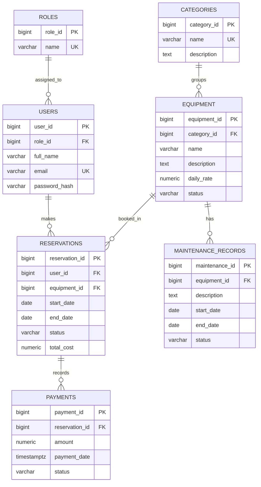
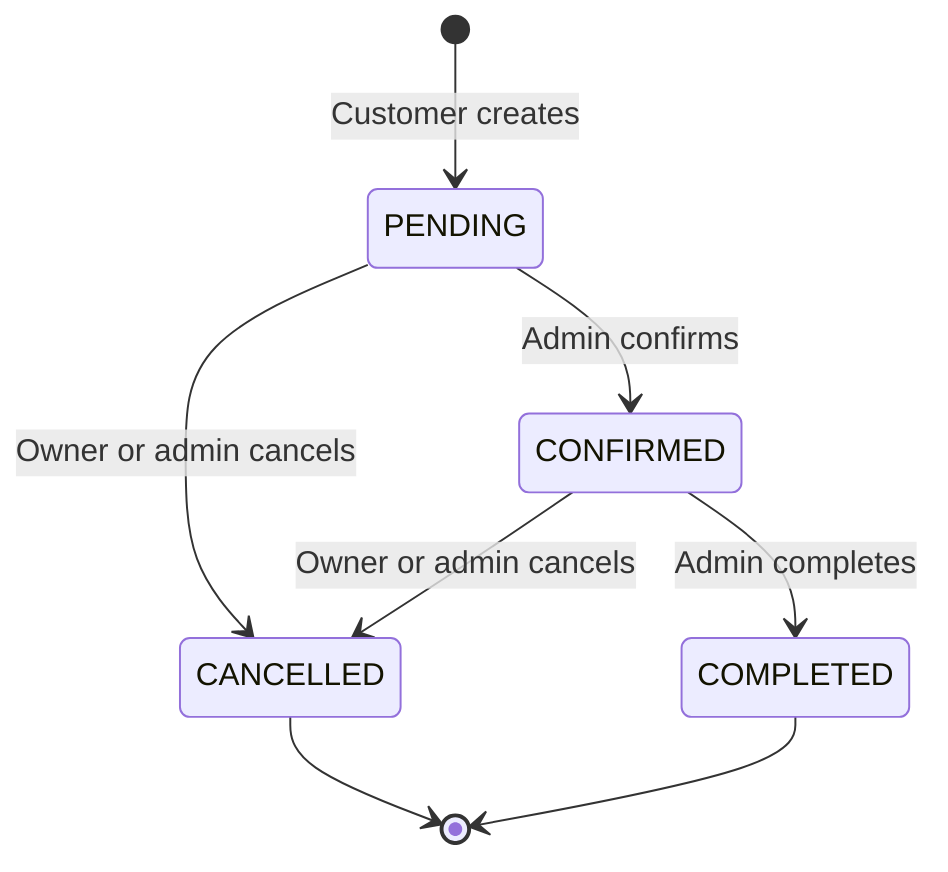
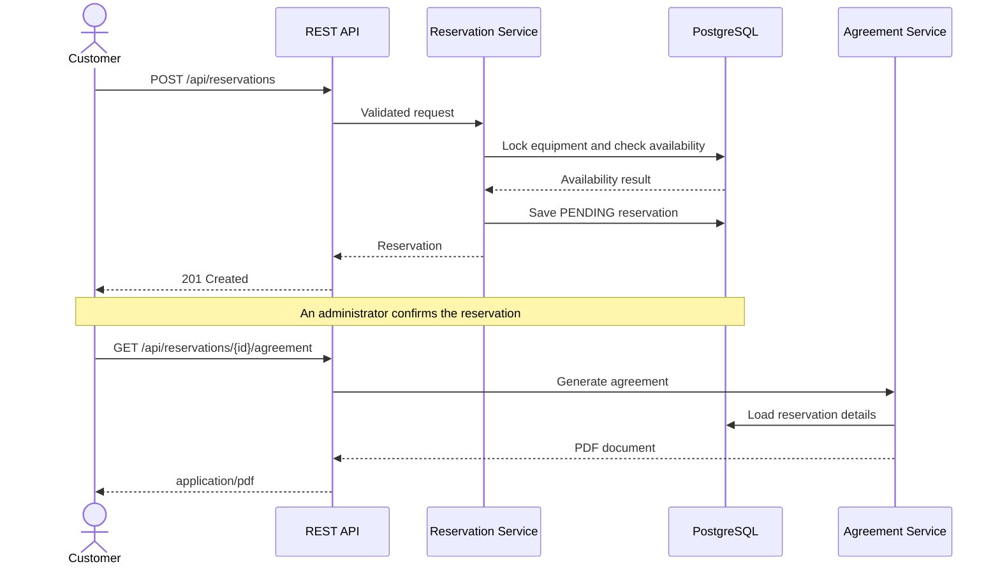

# Domain Documentation

## Entity relationship diagram

## Status values

| Entity | Values |
| --- | --- |
| Equipment | `ACTIVE`, `INACTIVE`, `MAINTENANCE` |
| Reservation | `PENDING`, `CONFIRMED`, `CANCELLED`, `COMPLETED` |
| Payment | `PENDING`, `PAID`, `FAILED`, `REFUNDED` |
| Maintenance | `SCHEDULED`, `IN_PROGRESS`, `COMPLETED`, `CANCELLED` |

The application currently records payments as `PAID` and `REFUNDED`. `PENDING` and `FAILED` are reserved in the schema for future payment workflows.

## Reservation lifecycle

## Reservation workflow

## Business rules

### Reservations

- A reservation requires `start_date` before `end_date`, and new reservations cannot start in the past.
- The end date is the return date and is not charged. A rental from March 10 to March 13 is three days.
- The backend calculates `total_cost` as `daily_rate * rental days`.
- Equipment must be `ACTIVE` and free of blocking maintenance and overlapping reservations.
- `PENDING` and `CONFIRMED` reservations block their dates. A new rental may start on another rental's return date.
- An equipment row lock serializes booking requests, and a PostgreSQL exclusion constraint guarantees that blocking reservations cannot overlap.

### Status changes and cancellation

- Customers can access only their own reservations and can only cancel them before the start date.
- Administrators can confirm, complete, and cancel reservations.
- A reservation cannot be confirmed while its equipment is not active.
- A reservation cannot be completed before its start date.
- `CANCELLED` and `COMPLETED` are final.
- Changing equipment to `INACTIVE` does not cancel existing reservations.

### Payments

- No external payment provider is integrated.
- Confirming a reservation records a `PAID` payment for the full amount.
- Cancelling a confirmed reservation changes that payment to `REFUNDED`.
- Only administrators can view payments.

### Maintenance

- `SCHEDULED` and `IN_PROGRESS` records block availability.
- Maintenance dates are inclusive. An empty end date means the maintenance is open-ended.
- Blocking maintenance cannot overlap a `PENDING` or `CONFIRMED` reservation.

### Catalogue

- `daily_rate` must be non-negative.
- Categories containing equipment cannot be deleted.
- Equipment with reservation or maintenance history cannot be deleted. Set it to `INACTIVE` instead.

### Accounts

- Passwords are stored only as BCrypt hashes.
- Email addresses are unique and compared without regard to case.
- Public registration cannot assign the `ADMIN` role.
